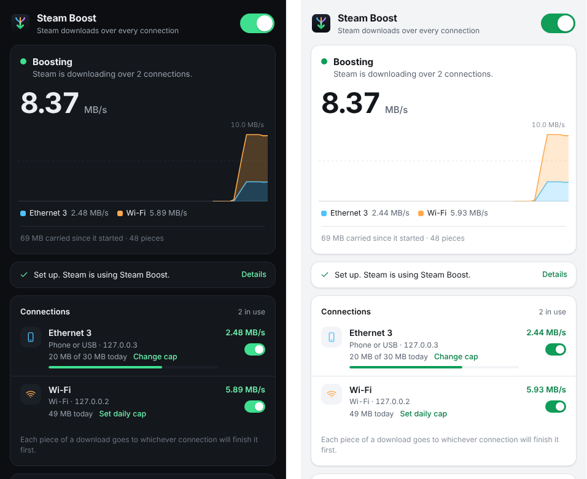

<p align="center">
  
</p>

<h1 align="center">Steam Boost</h1>

<p align="center">
  Steam downloads over every internet connection you have at once.<br />
  <a href="https://abeey04.github.io/steam-boost/">Website</a> ·
  <a href="https://github.com/Abeey04/steam-boost/releases/latest">Download</a>
</p>

<p align="center">
  
</p>

Steam Boost splits Steam's downloads across your Wi-Fi, Ethernet and phone, piece by piece, so a
game arrives at their combined speed. Home broadband plus your phone's mobile data over a USB
cable is the usual pair. It's free and open source (MIT), and it doesn't touch Steam, your games
or your account.

> **Pre-release.** Steam Boost is tested end to end against a simulated Steam (a mock content
> server and a client that downloads the way Steam does through a cache), and it has worked with
> the real Steam client on Windows. It's still early: if you try it, a note in the issues saying
> how it went, working or not, is the most useful thing you can send.

## How it works

Steam can download through a cache on your local network, a feature it has for LAN parties
([lancache.net](https://lancache.net/news/2020/01/14/steam-client-now-supports-lancache/)). When
Steam starts, it looks up `lancache.steamcontent.com`; if that name points at a private address,
Steam sends its content requests there over plain HTTP, naming the real content server in the
`Host` header, and falls back to its own servers whenever the cache can't help.

Steam Boost is that cache, on your own PC, and it caches nothing:

1. **Set up** adds one line to your hosts file, `127.0.0.1 lancache.steamcontent.com`, so the cache
   Steam finds is Steam Boost.
2. Steam asks for a game in chunks of about a megabyte, many at a time. Each chunk goes to the
   connection that will finish it soonest, judged from each connection's speed, latency and
   backlog. A slow connection still carries its share without holding up the fast one, a
   connection that keeps failing is rested, and a straggler is raced on another connection.
3. Chunks arrive encrypted with the game's depot key, and Steam checks each against its checksum,
   so nothing Steam Boost does can change a game: a bad chunk would be rejected, never installed.

Each connection is used by binding its sockets to that adapter's address (and, on Linux, to the
device itself), which is how [Plexo](https://github.com/anmolkapil/plexo) splits a file across
connections; Steam Boost's networking code comes from it. If Steam ever talks HTTPS to the cache
(reported on Linux and the Steam Deck), Steam Boost passes each connection through to the server
it names, over one of the connections, the way LANCache does.

## Using it

1. **Connect a second internet connection.** On Android, plug the phone in and turn on Settings ›
   Network & internet › Hotspot & tethering › USB tethering. Wi-Fi and Ethernet to the same router
   share one line, so that pair adds nothing.
2. **Open Steam Boost.** Its window shows three steps:
   - _Listening on 127.0.0.1:80_: it's ready for Steam.
   - _Point Steam here_: click **Set up…** and approve the administrator prompt.
   - _Restart Steam_: click **Restart Steam**. Steam only looks for a cache as it starts.
3. **Download something in Steam.** Each connection's speed shows in the window, and in the chart.

Give your phone a **daily cap** (Set daily cap, under its connection) to keep your mobile data in
check: Steam Boost stops using it once the day's cap is reached and starts again at midnight.
Closing the window keeps the boost running in the tray; quit from the tray icon. **Undo setup**
(in Settings) takes the hosts-file line out again: do that before you uninstall.

### If Steam doesn't use it

- **Steam ignores 127.0.0.1.** Some Steam builds may not take a cache on loopback. If Steam has
  restarted and still sends nothing, the window offers **Use my LAN address**, which listens on
  your PC's LAN address instead, points Steam there and restarts it. The same switch is in
  Settings › Listen on.
- **Port 80 is taken.** Steam only talks to a cache on port 80. Find what holds it with
  `netstat -ano | findstr ":80 "` and `tasklist /FI "PID eq <pid>"`; IIS, XAMPP/Apache and old Skype
  are the usual ones. PID 4 is Windows' own HTTP service: `netsh http show servicestate` shows who
  registered it.
- **One connection drops when the phone is plugged in.** Windows keeps one internet connection
  by default. To allow both, run this as administrator and restart Windows:
  `reg add "HKLM\SOFTWARE\Policies\Microsoft\Windows\WcmSvc\GroupPolicy" /v fMinimizeConnections /t REG_DWORD /d 0 /f`
- **Everything goes over the phone, Steam Boost or not.** Windows often prefers a tethered phone
  for all traffic. Make Wi-Fi the default again with
  `Set-NetIPInterface -InterfaceAlias "Ethernet 3" -InterfaceMetric 500` (the phone's adapter
  name, as administrator). Steam Boost still uses the phone: it binds to each adapter directly.
- **Something else.** Settings › **Copy diagnostics** puts a report on the clipboard (versions,
  settings, the hosts-file line, Steam's cache log lines, Steam Boost's log). Paste it into an
  [issue](https://github.com/Abeey04/steam-boost/issues).

## Building it

You need Node.js 22 or newer.

```bash
npm install
npm run dev          # build, run, and rebuild + restart on every change
npm test             # the engine against a mock Steam CDN, plus the app's own pieces
npm run typecheck
npm run dist:win     # an installer in dist/ (dist:mac, dist:linux on those systems)
npm run build:cli    # out/cli/steam-boost-cli.mjs: the engine as a command-line tool
```

Commit `package-lock.json` after the first `npm install`, so every build gets the same versions.

| Where                         | What                                                                                                                                                      |
| ----------------------------- | --------------------------------------------------------------------------------------------------------------------------------------------------------- |
| `src/main/steam/`             | The engine: the cache Steam talks to (`steamBoost.ts`), which connection gets each chunk (`dispatcher.ts`), the hosts file, TLS pass-through, Steam's log |
| `src/main/network/`           | Connections: finding them, and opening sockets on each (from Plexo)                                                                                       |
| `src/main/boostController.ts` | Runs the engine the way the settings say, and watches whether Steam uses it                                                                               |
| `src/main/index.ts`           | The app: window, tray, settings, daily usage, update check                                                                                                |
| `src/renderer/`               | The window (React)                                                                                                                                        |
| `src/cli/`                    | `steam-boost-cli`: the engine without the app                                                                                                             |
| `test/`                       | `node --test` suites; `fixtures.ts` is the mock CDN and the Steam-like client                                                                             |
| `docs/`                       | The website, served by GitHub Pages                                                                                                                       |
| `build/`, `resources/`        | Icons (rendered from `build/icon.svg`)                                                                                                                    |

A development build reads two settings from its environment, which a packaged build ignores:
`STEAM_BOOST_TEST_NETWORKS="Wi-Fi=127.0.0.2=wifi,Phone=127.0.0.3=usb"` replaces the computer's
networks with these, and `STEAM_BOOST_USER_DATA` keeps settings and logs in another folder.

## Releasing

1. Set the new version in `package.json`, commit, and tag it: `git tag v0.2.0 && git push origin main v0.2.0`.
2. The Release workflow builds Windows, macOS and Linux and leaves a **draft** release with the
   installers and `steam-boost-cli.mjs`.
3. Publish the draft as a full release. The website's download buttons and the app's update notice
   use GitHub's latest release, which skips pre-releases. The buttons link to each file by name
   (`releases/latest/download/steam-boost-setup.exe`), so keep the names `electron-builder.yml`
   gives them.

Builds aren't code-signed yet. Windows shows a SmartScreen warning on first run: choose More info,
then Run anyway. macOS blocks the app the first time it's opened: go to System Settings › Privacy &
Security and click Open Anyway (macOS 15 no longer offers right-click › Open for this). If macOS
says the app is damaged, run `xattr -dr com.apple.quarantine "/Applications/Steam Boost.app"` in
Terminal and open it again.

## The website

`docs/` is the website: plain HTML and CSS, with download links straight to the latest release's
files, which `site.js` swaps for the exact ones when GitHub's API answers. GitHub Pages serves it at https://abeey04.github.io/steam-boost/ with the repository's Settings › Pages set to
**Deploy from a branch**, branch `main`, folder `/docs`.

### A custom domain, later

To move the site to steamboost.app once that domain is registered to you:

1. At the registrar, give the bare domain A records `185.199.108.153`, `185.199.109.153`,
   `185.199.110.153` and `185.199.111.153`, and AAAA records `2606:50c0:8000::153`,
   `2606:50c0:8001::153`, `2606:50c0:8002::153` and `2606:50c0:8003::153`. Give `www` a CNAME to
   `abeey04.github.io`. Delete the registrar's own parking records, and on Cloudflare make every
   record DNS only.
2. In Settings › Pages, enter `steamboost.app` as the custom domain. Once the DNS check passes,
   tick **Enforce HTTPS**. GitHub adds `docs/CNAME` in a commit of its own: pull it.
3. Point the project at the new address: `site` in `src/shared/project.ts`, `homepage` in
   `package.json`, and the canonical and `og:` addresses at the top of `docs/index.html`.

See GitHub's guide to [managing a custom domain](https://docs.github.com/en/pages/configuring-a-custom-domain-for-your-github-pages-site/managing-a-custom-domain-for-your-github-pages-site).

## Credits

- [Plexo](https://github.com/anmolkapil/plexo) by Anmol Kapil (MIT): the networking code in
  `src/main/network/` and the idea of splitting downloads across connections.
- [lancache.net](https://lancache.net), [SteamKit2](https://github.com/SteamRE/SteamKit) and
  [steam-lancache-prefill](https://github.com/tpill90/steam-lancache-prefill), for how Steam
  finds and talks to a cache.
- [Overpass](https://github.com/RedHatOfficial/Overpass) (SIL Open Font License), the website's typeface.

Steam Boost is not affiliated with Valve Corporation. Steam and the Steam logo are trademarks of
Valve Corporation.

## License

MIT. See [LICENSE](LICENSE).
